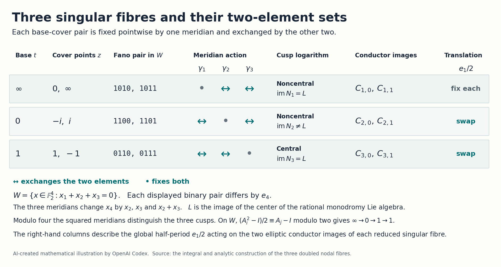
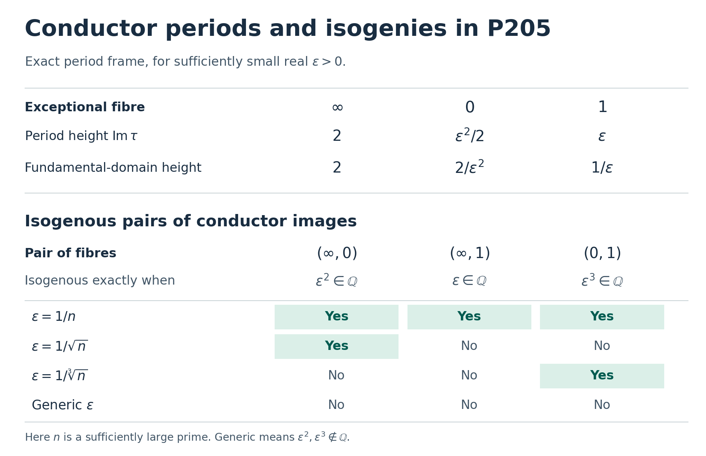

# Three pairs of branch points, a Fano plane and the first obstruction to symmetry

The six-sphere series, Paper II, Example P205 (*A compact fibration with three doubled nodal supports*) constructs a smooth compact complex threefold over a sphere. Each of the three exceptional fibres has multiplicity two. Its reduced surface has two distinct elliptic curves in the image of its normalization conductor. Each curve receives a degree-two isogeny from its own section. The integral monodromy of the smooth torus fibres gives a way to test what the repeated numbers two and three actually measure.

## The same six-element action in two places

Order the exceptional base values as $\infty,0,1$. Paper II's finite character cover is

$$
t=\tfrac14(z+z^{-1})^2,\qquad
g_1(z)=-z,\quad g_2(z)=-1/z,\quad g_3(z)=1/z.
$$

The three involutions form the nonidentity elements of a Klein four-group $D$. They fix the pairs $\{0,\infty\}$, $\{i,-i\}$, $\{1,-1\}$ respectively. On either of the other two pairs each involution exchanges the two points.

Now take $H=H_1(F,\mathbb Z)$ in the integral basis of P205, with meridian matrices $A_i$. Write $x_j$ for the coordinate functionals and $e_j$ for the basis vectors. The common integral fixed vector and covector lines have primitive generators $e_4$ and $\alpha=(1,1,1,2)$. Thus $W=\ker(\alpha\bmod2)$ is an intrinsically specified three-dimensional part of $H/2H$, the two-torsion of the smooth Jacobian. Its point $e_4$ is fixed. On the full space the differences $T_i=A_i-I\bmod2$ are

$$
T_1=e_4 x_2,\qquad T_2=e_4 x_3,\qquad T_3=e_4(x_2+x_3).
$$

The six other nonzero vectors of $W$ have $(x_2,x_3)=(0,1),(1,0),(1,1)$, with two possible last coordinates for each choice. In this order the three meridians fix respectively the first, second and third pair, swapping the other two. Matching the pairs in order gives an equivariant bijection with the six ramification points above. Each pair admits two choices of orientation.

This comparison recovers a specific statement from the GRH research manuscript, CX-GEO-005. The seven points and seven lines of the Fano plane have equal permutation characters for $\mathrm{GL}_3(2)$, because a matrix and its transpose have equal fixed-space dimension. In $W$ the image of monodromy is the subgroup $D$. On points the orbit sizes are $1,2,2,2$. On lines, the three nonzero forms annihilating $e_4$ are individually fixed and the remaining four form a regular orbit. Removing one fixed object on each side gives $2+2+2$ and $4+1+1$. The six-element actions have equal traces on every group element. Only the second has points fixed by the entire group. The same two actions occur among explicit Albert-algebra projectors. [Albert and Leech flag coordinates](albert_flags.md) · [Circuit consequences of the two six-sheet actions](geometry_transfer.md)

[Reproduce the diagram](checks/conductor_pairs.py)

## Four-torsion distinguishes the three exceptional values

At level two, linear automorphisms of $W/\langle e_4\rangle$ permit all six permutations of the three nonzero directions. With one more binary digit the situation changes. Define $K_i=(A_i^2-I)/2\bmod2$. This uses only the matrices modulo four. Multiplication of the integral matrices in P205 gives

$$
K_1=e_4x_3,\qquad K_2=K_3=e_4x_1 .
$$

Each $K_i$ commutes with every reduced meridian, since all the rank-one maps displayed here have image spanned by $e_4$ and kill $e_4$. Hence changing the base paths does not change these comparisons. Inversion of a meridian gives the same divided square modulo two. The equality $K_2=K_3\ne K_1$ distinguishes cusp 1, and then $K_1=T_2$ distinguishes cusp 2 from cusp 3. On $W$ one has $x_1=x_2+x_3$. Sending each cusp to the cusp whose $T$ equals its $K$ gives

$$
\infty\longmapsto 0\longmapsto 1\longmapsto 1.
$$

This directed graph has only the identity automorphism. In particular every automorphism of the compact fibration covering a base automorphism fixes each exceptional value. The rational monodromy gives a second check. On its three-dimensional summand $N_1=\log B_1^2$, $N_2=\log B_2^2$, $N_3=\log B_3^2$ are multiples of $E_{23},E_{31},E_{21}$ with $[N_1,N_2]=4N_3$ and $[N_i,N_3]=0$.

The two conductor images in a singular fibre have another geometric meaning. In the root compactification the cyclic quotient exchanges the two components and preserves both node parities. Its two sections give separate copies of the isogeny $E/\langle1/2\rangle\to E/\langle1/4\rangle$. There is nevertheless a genuine simultaneous swap: translation by the global flat half-period $e_1/2$ preserves each image over $\infty$ and exchanges the pair over both $0$ and $1$. In the three local bases its doubled period has last coordinate $0,1,1$. A translation with last coordinate $d$ multiplies the local multiplicative coordinate by $r^d$ times a holomorphic unit. It therefore carries the chain chart indexed by $k$ isomorphically to that indexed by $k+d$, including the central fibre. Odd $d$ reverses node parity. The global monodromy fixes this translation, and the local and global translations agree on their overlap. This exhibits one of the double transpositions on the conductor curves themselves. [Integral calculations](checks/conductor_symmetries.py)

## The actual conductor moduli

Before introducing another elliptic family one can compute what happens to the **actual conductor images**. Let $\epsilon>0$ be the small deformation parameter of P205, and fix one of its holomorphic equivariant trivializations specializing to the prescribed basis at $\epsilon=0$. In the following table the $e_0,e_1,e_2,e_3$ are the real period basis of P205. In each local integral basis $(a,b,c,d)$ set $p=2a-c$. Multiplying the three changes of basis by the displayed real lattice matrix $D_\epsilon P$ gives

| Exceptional value | $p$ | $b$ | Direction of $c$ |
|---|---|---|---|
| $\infty$ | $-e_0$ | $-(e_0+e_1)/2$ | $e_2$ |
| $0$ | $-e_0$ | $-e_0/2-\epsilon^2e_2/8$ | $e_3$ |
| $1$ | $e_0$ | $\epsilon e_3/4-\epsilon^2e_2/8$ | $e_2$ |

Let $\Pi_i$ be a local two-row frame for the canonical period plane at the marked lift. Define $R_i(v)=\det(\Pi_i v,\Pi_i c')/\det(\Pi_i e_0,\Pi_i c')$, where $c'$ is the direction in the last column. Dividing by the scale of $c$ before taking the limit avoids a singular normalization. The logarithmic period correction kills $p,b,c$. The actual period ratio $\tau_i$ of the elliptic base in the root chart is $R_i(b)/R_i(p)$, with the lower-half-plane convention of P205. The limiting twistor parameters are $\infty,i,-1$. Substitution in the printed two-row frames gives $R_1(e_1),R_2(e_2),R_3(e_3)\to-i$, with respective limiting denominators $1,2i,2$. Holomorphic dependence then gives

$$
\tau_1=\tfrac12(1-i)+O(\epsilon),\quad
\tau_2=\tfrac12-i\epsilon^2/8+O(\epsilon^3),\quad
\tau_3=-i\epsilon/4+O(\epsilon^2).
$$

Each of the two conductor sections is the quotient by $1/2$, and each conductor image is the quotient by $1/4$. Their upper-half-plane period ratios can be taken as $-2\tau_i$ and $-4\tau_i$. At $\infty$ the **section** therefore tends to $j(i)=1728$ and the **image** tends to $j(2i)=287496$. For the second value, multiplication by $i$ exchanges two of the three order-two subgroups of $y^2=x^3-x$. Quotienting a square lattice by a half of one of its two coordinate periods gives the rectangular period $2i$ up to a change of basis. In the cubic this corresponds to the roots $1,-1$. Translation of the root $1$ to zero gives coefficients $a=3,b=2$ in $y^2=x^3+ax^2+bx$. Its 2-isogenous curve has $a=-6,b=1$ and hence $j=256(a^2-3b)^3/(b^2(a^2-4b))=287496$.

Write $J_2,J_3$ for the ordinary image invariants at $0,1$ in the same threefold. Translating by an integer and inverting the arguments brings both to the cusp at infinity. From $j(q)=q^{-1}+744+O(q)$ one obtains

$$
\log|J_2|\sim 4\pi/\epsilon^2,\qquad
\log|J_3|\sim 2\pi/\epsilon .
$$

Thus all three pairs of image curves have distinct moduli for sufficiently small positive $\epsilon$. Each pair over a *single* base value still consists of isomorphic curves. The square-lattice limit belongs to the sections of the first singular surface and makes a geometric appearance of 1728 in the threefold construction itself. [Period and basis calculations](checks/conductor_symmetries.py)

For every fixed degree bound $D$, curves from different exceptional fibres also admit no isogeny of degree at most $D$ for sufficiently small $\epsilon$. A bounded-degree isogeny has only finitely many sublattice types. A period in a compact part of the moduli space has images in a compact part. For periods high in the standard cusp, a degree-$n$ image has an upper-triangular representative $(a\tau+b)/d$ with $ad=n$. The ratio of the two heights then lies between $1/n$ and $n$. The two divergent heights above have unbounded ratio. For a fixed holomorphic family as above, the modular equations are analytic on the positive interval, and none can vanish identically. Outside a countable exceptional set of parameters the conductor images from different fibres are therefore pairwise nonisogenous.

### An exact deformation with different isogeny patterns

The construction permits a choice of global equivariant frame for the period bundle. One such choice turns the three leading terms into exact periods. The trivial-character covector can be taken to be the flat $e_0^*$. Let $\sigma_i$ be the generator for the nontrivial character fixed by the $i$th inertia involution. It annihilates the flat vector $e_0$: evaluation gives a holomorphic function on the compact $z$-sphere with nontrivial character, hence zero. At the corresponding marked lift put

$$
h_1=e_1,\qquad h_2=e_2,\qquad h_3=e_3-\epsilon e_2/2 .
$$

These vectors lie in the positive eigenspaces of the respective finite parts; at $\epsilon=0$ the chosen $\sigma_i$ evaluates to one on $h_i$. Rescale each $\sigma_i$ by the reciprocal of this value at its own marked point, a nowhere-zero holomorphic function of $\epsilon$ on a sufficiently small disc. The other two nontrivial characters vanish on this positive eigenspace. In the normalized character frame the positive twistor row restricts there to $e_0^*-i\sigma_i$. The three ratios $R_i(h_i)$ are now exactly $-i$. This rescaling preserves the specialization that the existence and transversality proof uses. In this particular admissible family the two image curves at each cusp have, up to integral changes of period basis, the following **exact** upper-half-plane periods:

$$
\rho_\infty=2i,\qquad \rho_0=i\epsilon^2/2,\qquad \rho_1=i\epsilon .
$$

This gives an if-and-only-if test on the curves themselves. Two rectangular periods $iu,iv$, $u,v>0$, are isogenous over $\mathbb C$ precisely when $v/u$ or $uv$ is rational. Indeed a rational matrix of positive determinant carrying $iu$ to $iv$ must satisfy $b=-cuv$ and $a=dv/u$. At least one of $c,d$ is nonzero. Conversely a positive rational ratio gives a diagonal matrix and a positive rational product gives an off-diagonal matrix. Applying the criterion to all three pairs gives

| Exceptional values compared | Their elliptic images are isogenous exactly when |
|---|---|
| $\infty,0$ | $\epsilon^2\in\mathbb Q$ |
| $\infty,1$ | $\epsilon\in\mathbb Q$ |
| $0,1$ | $\epsilon^3\in\mathbb Q$ |

For a sufficiently large prime $n$, choosing $\epsilon=1/n$ puts all three pairs of images in the isogeny class of the square lattice. Choosing $1/\sqrt n$ joins just the images over $\infty,0$, and choosing $1/\sqrt[3]n$ joins just those over $0,1$. For a positive transcendental $\epsilon$ small enough for the construction, no two distinct exceptional values have isogenous images. The monodromy matrices in the integral basis are identical in all four examples. The three-pair permutation data alone therefore cannot recover these isogenies.

The exact classification belongs to the specified family. Multiplying each normalized $\sigma_i$ by an independent holomorphic unit with value one at zero changes the higher-order period terms. The displayed leading limits and growth rates continue to hold for those choices.

[Reproduce the isogeny table](checks/period_isogenies.py)

## An auxiliary modular family on the same base

Give the same punctured base its auxiliary Legendre curve $y^2=s(s-1)(s-t)$. This is a choice of elliptic family on the base. The period construction of P205 supplies a family of two-dimensional tori. An identification of the auxiliary Legendre curve with a conductor elliptic curve would require another geometric map.

On the $z$-line both $\sqrt t=(z+1/z)/2$ and $\sqrt{t-1}=(z-1/z)/2$ are available. Over $\mathbb C$ these are the radicals for halving two independent Legendre 2-torsion points, giving the usual map $X(4)\to X(2)$. The ordinary $j$-invariant becomes

$$
j(z)=\frac{16(z^8+14z^4+1)^3}{z^4(z^4-1)^4}.
$$

The shared $X_0(2)$ coordinate and the lambency-six coordinate $x$ satisfy

$$
L=\frac{4t}{(1-t)^2}
 =\frac{x^3(x+8)}{64(x+9)^3},\qquad j=\frac{64(L+4)^3}{L^2}.
$$

The normalized fibre product $Y$ is connected of degree four over $z$. Indeed the geometric $z$-cover of $L$ is dihedral of order eight. One can generate it with $z\mapsto-z$ and $z\mapsto(z+i)/(iz+1)$. The $x$-cover has branch partitions $(3,1),(3,1),(2,2)$ over $0,\infty,-1$. Its geometric Galois closure has group $A_4$, by transitivity and the even branch cycles. The two Galois groups have no common nontrivial quotient. The pullback cancels the order-two ramification over $-1$ and leaves one ramification point of index three above each of $z=0,\infty,\pm1,\pm i$. Thus $2g(Y)-2=-8+6\cdot2=4$. Its modular group is the projective image of $\Gamma(4)\cap\Gamma_0(3)$, conjugate to the image of $\Gamma_0(48)$ by $\operatorname{diag}(4,1)$. In particular $Y_{\mathbb C}$ is $X_0(48)_{\mathbb C}$. [Maier, Tables 2 and 4](https://arxiv.org/abs/math/0611041) · [Level-six coordinates](modular_coordinates.md) · [Bekker and Zarhin, halving on elliptic curves](https://arxiv.org/abs/1702.02255)

## A point-count prediction from the Fano comparison

The intermediate $(x,t)$-field is rational. Set $x=u^2-9$ and

$$
t=\frac{(u-3)^3(u+1)}{(u+3)^3(u-1)}.
$$

Conversely $u=(x^2+36x+216)(1-t)/(8(x+9)(1+t))$ on a dense open set. Over this line, $Y$ is the biquadratic extension obtained by adjoining $\sqrt t,\sqrt{t-1}$. Its three quadratic quotients are the genus-one curves with square roots of

$$
f_1=(u^2-9)(u^2-1),\quad
f_2=-u(u+3)(u-1),\quad
f_3=-u(u-3)(u+1).
$$

Each has a rational point. The three pullbacks of holomorphic differentials belong to different nontrivial characters of the four-group, and exhaust the differentials of $Y$. Consequently the product of the three quotient Jacobians is isogenous over $\mathbb Q$ to $\operatorname{Jac}(Y)$. This is the same character identity as $4+1+1$ versus $2+2+2$: the regular representation plus two trivial representations is the sum of the three index-two permutation representations.

Put $E_+\colon y^2=v(v+3)(v-1)$. The change $u=(3-v)/(v+1)$ gives $f_1=64v(v+3)(v-1)/(v+1)^4$; the substitution $u=-v$ sends $f_3$ to the same cubic. The middle quotient is precisely its twist $E_-$ by $-1$. Thus over $\mathbb Q$

$$
\operatorname{Jac}(Y)\ \sim\ E_+^2\times E_- .
$$

For any finite field of characteristic greater than three, write $a_q=q+1-\#E_+(\mathbb F_q)$ and let $\chi_q$ be the quadratic character. The consequence is

$$
\#Y(\mathbb F_q)=q+1-(2+\chi_q(-1))a_q .
$$

For example $a_{11}=4$ gives eight points, and $a_{13}=-2$ gives twenty. The checker counts on the normalized cover with the additional coordinate $y_3^2=f_3$ and the relation $y_1y_2=(u+3)(u-1)y_3$. This retains the two branches over a common zero of $f_1$ and $f_2$. It adds the two rational points over infinity. [Point-count replay](checks/conductor_symmetries.py)

One can now test a stronger symmetry claim. The common elliptic invariant is $35152/9$. Since a complex multiplication invariant is an algebraic integer, the elliptic factors have no complex multiplication. Hence $\operatorname{End}^0(\operatorname{Jac}(Y)_{\mathbb C})=M_3(\mathbb Q)$. A rational matrix of order seven would require the cyclotomic polynomial $\Phi_7$ of degree six in its minimal polynomial. Thus the full group $\mathrm{GL}_3(2)$, which contains elements of order seven, cannot act faithfully on this Jacobian by origin-preserving automorphisms, even up to isogeny. The smaller four-group does give the three quotient curves and the trace formula above. The conductor period limits also rule out any bounded-degree identification with $E_+$ near $\epsilon=0$: two invariants escape every compact set, and the other tends to a CM value, whereas every isogenous curve to $E_+$ is non-CM. At fixed degree the isogeny orbit of $E_+$ is finite. [Complex multiplication, Milne, *Modular Functions and Modular Forms*](https://www.jmilne.org/math/CourseNotes/MF.pdf)

The geometric example and its period matrices come from the AI-produced six-sphere Paper II, Example P205. The point/line comparison comes from the GRH research manuscript, CX-GEO-005. The comparisons of these sources, the modular base change, and the finite calculations in this chapter are AI-produced by OpenAI Codex.
