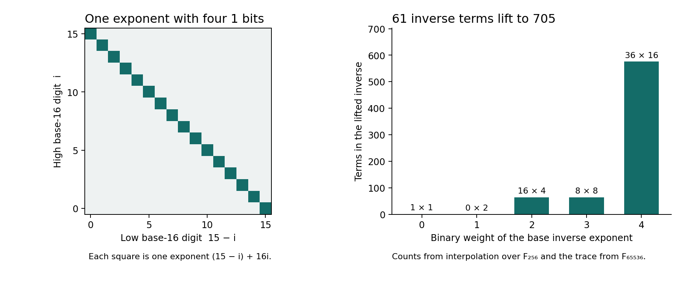

# How many terms certify that a sparse polynomial has no root?

Let $K$ be a finite binary field. A polynomial $H\in K[X]$ has no root in $K$ precisely when it has an inverse modulo $X^{|K|}-X$. One way to certify this is to write out a Bézout identity

$$
       H(X)C(X)+(X^{|K|}-X)D(X)=1.
$$

There are polynomials $H$ with polynomially many written bits for which **every such identity has exponentially many monomials in $C$**, measured in the binary dimension of $K$. The examples below use only a constant and powers $X^{2\cdot4^i+4^j}$. Their binary coordinate equations come from commuting Hermitian matrices on pairs of quaternary coordinates. One family also requires high degree in binary polynomial calculus. A second family already contains the contradictory coordinate equation $1=0$. The distinction identifies what can be inferred from a long written inverse.

Sparse univariate polynomials can encode Boolean systems. Milovanov gave a parsimonious reduction for sparse root counting. Our question concerns the form of an unsatisfiability certificate for a particular quadratic encoding. [Milovanov, *#P-completeness of counting roots of a sparse polynomial*](https://doi.org/10.1016/j.ipl.2018.09.008)

## How a quadratic extension expands an inverse

Let $E=\mathbb F_Q$, where $Q=2^m$, and let $A=\sum_{0\le e<Q}a_eX^e$ be the unique reduced inverse of a rootless $H$. In $E'=\mathbb F_{Q^2}$, put

$$
             T(X)=X+X^Q,\qquad H'(X)=H(T(X)).
$$

The relative trace $T:E'\to E$ is onto. The function $A(T(X))$ is therefore the inverse of $H'$ on $E'$. Write $\operatorname{wt}_2(e)$ for the number of ones in the binary expansion of $e$. Then

$$
      \boxed{\quad |\operatorname{supp}(A\circ T)|
           =\sum_{e:\,a_e\ne0}2^{\operatorname{wt}_2(e)}.\quad}       \tag{1}
$$

Indeed, every bit of $e$ chooses one of the two Frobenius summands. If the bits choosing the second summand form the integer $i$, the resulting exponent is $(e-i)+Qi$. Its two base-$Q$ digits are $e-i$ and $i$. They recover both $e$ and the choice of summands. All these exponents are below $Q^2$, so neither collection of like terms nor reduction in the function ring loses a term. For instance $e=13=1101_2$ gives the eight choices $i=0,1,4,5,8,9,12,13$.

Every candidate Bézout cofactor $C$ reduces to this same $A\circ T$. Reducing a monomial modulo $X^{Q^2}-X$ sends it to one monomial, so the cardinality in (1) is a lower bound on the number of terms in *every* $C$, even if larger exponents are allowed. For even $m$, the substitution preserves the shape $2\cdot4^i+4^j$ of each nonconstant input exponent. Each one contributes at most four terms to $H'$.

The left panel shows the sixteen exponents contributed by $e=15$ at $Q=16$. The right panel groups the terms of an inverse at $Q=256$ by their binary weights. Each term of weight four contributes sixteen terms to the lifted inverse.

## From proof degree to one exponent

Fix a binary basis for $E$ and suppose the coordinate equations $h_j(x)=0$ of $H(x)=0$ have multilinear degree at most two. Polynomial calculus over $\mathbb F_2$ derives polynomial equations by addition and multiplication by a variable. The bit equations $x_i^2+x_i=0$ are available as axioms. The degree of a refutation is the largest ordinary total degree of any line in a derivation of $1=0$. Let $D_H$ be the minimum such degree.

If every exponent of $A$ has binary weight at most $r$, every coordinate of $A(x)$ has Boolean degree at most $r$, since $x\mapsto x^{2^j}$ is binary linear. In fact the maximum binary exponent weight is exactly the degree of the vector-valued Boolean function. For the reverse inequality, the reduced monomials of weight at most $r$ are independent over $E$. Their number is the dimension $\sum_{j=0}^r\binom mj$ of the space of $E$-valued multilinear Boolean functions of that degree. [Carlet, *Boolean Functions for Cryptography and Error Correcting Codes*, pp. 14–17](https://www.math.univ-paris13.fr/~carlet/chap-fcts-Bool-corr.pdf)

Choose a binary linear functional $\lambda:E\to\mathbb F_2$ with $\lambda(1)=1$. Bilinearity of field multiplication gives a Boolean-function identity

$$
             1=\lambda(H(x)A(x))=\sum_j h_j(x)b_j(x),
                 \qquad \deg b_j\le r .
$$

Derive the sum by multiplying each coordinate axiom by the monomials of $b_j$. Its ordinary degree is at most $r+2$. Termwise multilinearization using the bit equations then yields 1 at the same degree. Hence

$$
                       D_H\le r+2.                               \tag{2}
$$

Combining (1) and (2), the reduced inverse after the trace has at least $2^{D_H-2}$ terms.

## A commuting block with an affine section

Choose $\omega\in\mathbb F_4$ with $\omega^2+\omega=1$. On two input coordinates $a,b\in\mathbb F_4$, measure

$$
 \Phi(a,b)=\bigl(a^3+b^3,\;a^2b+ab^2\bigr).
$$

The two matrices are the identity and the swap. The outputs $00,10,01$ have 4, 6 and 6 preimages respectively. Thus the output bits satisfy $uv=0$. There is also a linear choice of physical inputs whose error on the remaining output pair is exactly that equation:

$$
    s(u,v)=(u+\omega v,v),\qquad
    \Phi(s(u,v))=(u+uv,v)\quad(u,v\in\mathbb F_2).
$$

Take any number of these blocks and couple their output pairs by affine binary equations. Denote by $D_L$ the refutation degree using output bits, their local equations $uv=0$, and the affine couplings. Denote by $D_P$ the degree using the physical binary bits and the couplings evaluated at $\Phi$. In both presentations include the corresponding bit axioms. Then

$$
           D_L\le\max(2,D_P),\qquad D_P\le\max(4,2D_L).
$$

For the first bound substitute $s$ into each physical proof line. A coupling differs from its logical version only by a sum of the local exclusions, modulo bit equations derivable in degree two. For the second substitute $\Phi$ into each logical line. An exclusion or a bit axiom becomes a degree-at-most-four polynomial vanishing everywhere on its Boolean cube, so multilinearization derives it from physical bit axioms at that degree. Multiplication by a logical bit is simulated by multiplication by each monomial of a quadratic coordinate followed by addition. This is a particular degree-preserving substitution. The general role of bounded local substitutions in proof complexity is developed by Atserias and Ochremiak. [Atserias–Ochremiak, *Proof Complexity Meets Algebra*, §3](https://arxiv.org/abs/1711.07320)

For the univariate packing, write $E=\mathbb F_{4^d}$ in a quaternary basis. Each quaternary input coordinate is a quaternary-linearized polynomial in $X$, a sum of $X^{4^i}$. Indeed the first $d$ such powers give independent functions over $E$, since a nonzero polynomial of degree at most $4^{d-1}$ cannot vanish on $E$. They thus span all quaternary-linear maps $E\to E$. Packing the affine coupling residuals into independent binary output tags gives a constant plus powers $X^{2\cdot4^i+4^j}$, with at most $d^2$ nonconstant terms. Sufficient padding to fit all tags adds free input coordinates. In a quadratic extension with basis $1,\eta$ and $\eta^Q=\eta+1$, the trace is simply $T(u+v\eta)=v$. It preserves the displayed coordinate equations on $v$ and adds free coordinates $u$.

## A family that also requires hard Boolean refutations

Use a bounded-degree bipartite boundary expander with $n+1$ pigeons and $n$ holes. Give each edge $e$ a block with output $(x_e,0)$. For each pair $e,f$ sharing a vertex add a block with required output $(x_e,x_f)$. Its missing output forbids selecting both edges. Require the incident edge bits of every pigeon to sum to one modulo two. A solution would inject the pigeons into the holes. There are $O(n)$ blocks and affine rows, each involving only a bounded number of blocks.

Pull a physical refutation back to the original functional pigeonhole CNF by substituting $s(x_e,0)$ and $s(x_e,x_f)$. Its only conflict defects are the original clause polynomials $x_ex_f$. For a pigeon with incident indicators $x_1,\ldots,x_h$, the original positive clause gives $\prod_i(1+x_i)=0$. Its difference from $1+\sum_i x_i$ is a sum of monomials each divisible by an original pair conflict, derivable in degree at most $h$. All substitutions of physical bits are affine. Thus a physical refutation of degree $D$ yields an original one of degree at most $\max(D,2,h_{\max})$. Mikša and Nordström's degree lower bound on functional graph pigeonhole now gives $D_H=\Omega(n)$. The resulting extension field still has binary dimension $\Theta(n)$, so (1)–(2) give the claimed exponential term bound. [Mikša–Nordström, *A Generalized Method for Proving Polynomial Calculus Degree Lower Bounds*, Theorem 4.9](https://jakobnordstrom.se/docs/publications/GeneralizedMethodPCdegree_CCC.pdf)

There is also a statement about resolution whose lines are disjunctions of binary parity equations. In the local block basis, encode each physical equation by listing a clause for each forbidden local assignment. A forbidden-assignment indicator $I$ for the equation $h=0$ has $Ih=I$ on the Boolean cube, so its clause polynomial is derivable from $h$ in constant degree. This ordinary CNF has constant width, $O(n)$ bits and linear refutation degree over $\mathbb F_2$. The public Lean degree-to-size theorem for dag-like resolution over parity equations therefore gives $\exp(\Omega(n))$ lines. Its exact hypotheses include $32w\le D$, $32\le D$, and absence of a degree-$D$ polynomial-calculus refutation. The cited Lean theorem is recorded as kernel-checked. The construction and deductions in this chapter are paper proofs. The constant-width statement uses the displayed local coordinate basis. [Public degree-to-size theorem and proof](https://data.pequalnp.com/artifacts/L-pcx-042/3685efe00222.lean)

## An immediate contradiction with a dense inverse

For an explicit comparison take $m=2d$, let $z_1,\ldots,z_d$ be the quaternary coordinates in $E$, let $\beta_1,\ldots,\beta_d$ be binary independent, and choose $c$ outside their binary span $W$. Set

$$
              H(x)=c+\sum_i\beta_i z_i^3.
$$

In an output basis containing $c$ and the $\beta_i$, the $c$-coordinate already gives $1=0$. Nevertheless the coefficient of $X^{Q-1}$ in the reduced inverse is nonzero. Summing the reduced inverse over all $x\in E$ selects exactly that coefficient. Each norm bit $z_i^3$ has fiber sizes one and three, both odd. Consequently the sum simplifies to

$$
       \sum_{w\in W}\frac1{c+w}=\frac{P_W'(c)}{P_W(c)},\qquad
                  P_W(X)=\prod_{w\in W}(X+w).
$$

The subspace polynomial is additive with nonzero constant derivative. For example, adjoining an independent vector $v$ replaces $P_W(X)$ by $P_W(X)(P_W(X)+P_W(v))$, which proves the assertion by induction. Hence the exponent $Q-1$ alone contributes $2^m$ terms after the trace. The proof degree is zero in the indicated output basis.

In one coupled example on two physical blocks, define $y_i=(u_i,v_i)=\Phi(a_i,b_i)$ and impose $u_1=1$, $u_1+u_2=0$, $v_1+v_2=1$. The first two force both $u_i$ to be one, hence both $v_i$ to be zero. For reproducibility, take a primitive θ with θ⁸+θ⁴+θ³+θ²+1=0, set ω=θ⁸⁵, use 1, θ, θ², θ³ as the quaternary basis and tag the three displayed residuals by 1, θ, θ². Complete interpolation over $\mathbb F_{256}$ gave 17 input terms and 61 inverse terms. Over $\mathbb F_{65536}$ the corresponding counts were 65 and 705. Evaluation at every one of the 65,536 field elements verified the product identity. The diagonal comparison at $m=10$ gave 19,845 inverse terms after trace, computed from interpolation over the 1,024-element base field and (1).

The exponential bound concerns an expanded list of ordinary monomials. On every rootless instance a repeated-squaring circuit computes the inverse function as $H'(X)^{\,Q^2-2}$ with $O(\log Q)$ field operations. The length of a written inverse and the complexity of deciding root existence are different quantities.
