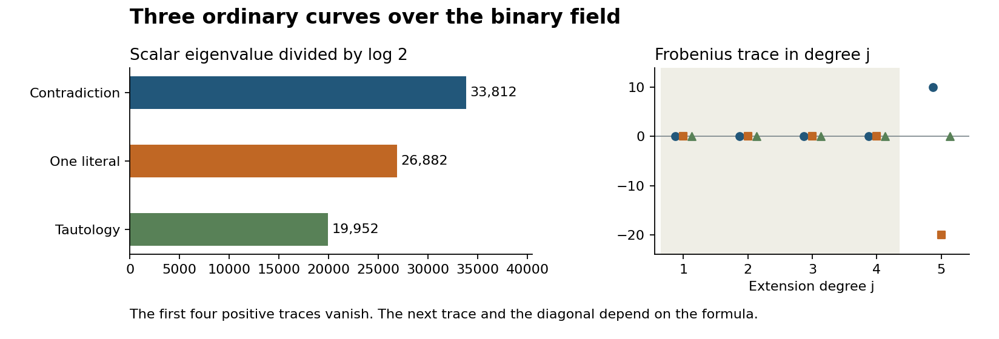

# A scalar Weil operator with a prescribed window of zero traces

Fix a prime $p$. Given a 3-CNF formula $\Phi$ and a positive integer $J$ in unary, one can write two sparse equations over $\mathbb F_p$ for an affine open of a smooth projective ordinary curve $C$. For every $1\le j\le J$, its projection to the projective line induces a bijection on $\mathbb F_{p^j}$-points. Consequently, its first $J$ positive Frobenius traces are zero. Yet the multiplicity of Frobenius eigenvalues in $H^1(C)$ determines the number $S$ of satisfying assignments to $\Phi$.

For Suzuki's local Weil operator this gives an exact separation between two kinds of data. Throughout $0<2a\le (J+1)\log p$, every nonzero test function is an eigenfunction with the same eigenvalue. Determining that eigenvalue from the sparse equations is #P-hard under a polynomial-time metric reduction. All the equations below have bit length polynomial in $|\Phi|+J$. In particular $J$ can be any prescribed polynomial in the original formula length.

## From a sparse pair to the curve

Use a sparse pair $A(T),B(T)=T^N-1$ over $\mathbb F_p$ together with a known integer $\kappa$ satisfying
$$
 p\nmid N\kappa,\qquad \deg A<N,\qquad A(1)=1,\qquad
 \deg\gcd(A,B)=\kappa S.
$$
The explicit construction from $\Phi$ appears below. Define
$$
 D=\operatorname{lcm}_{1\le j\le J}(p^j-1),\qquad
 f(X)=\frac{A(X^D)}{B(X^D)}+X+\frac1X .
$$
The curve is the smooth projective completion of $Y^p-Y=f(X)$. Its input consists of coefficient lists with binary exponents for the equations
$$
 E(X)W=1,\qquad Y^p-Y=F(X)W,
$$
where $E=XB(X^D)$ and $F=XA(X^D)+(X^2+1)B(X^D)$. Each old term of $A$ supplies one new term, the other summand supplies at most four, and $\log D\le J(J+1)\log(p)/2$. The first equation removes the zeros of the given denominator. The $Y$-derivative is $-1$, so this presentation gives a smooth affine curve and specifies its function field.

There are $N-\kappa S$ true poles of $A/B$, all simple, finite and nonzero. Since $p\nmid D$, the map $X\mapsto X^D$ has $D$ distinct unramified preimages over each of these poles. The added $X+1/X$ gives a simple pole at each of zero and infinity. The original summand is regular at both. With $b=D(N-\kappa S)+2$ geometric poles, the genus and geometric $p$-rank are therefore
$$
 g(C)=\gamma(C)=(p-1)(b-1)=(p-1)\bigl[D(N-\kappa S)+1\bigr].
$$
Indeed a simple pole rules out an expression $g^p-g$ over the geometric rational function field, giving geometric integrality. Every simple pole has different exponent $2(p-1)$. Riemann–Hurwitz gives the genus and Deuring–Shafarevich gives the $p$-rank. Their equality proves ordinarity. [Pries and Zhu, §2.2, Lemma 2.6](https://doi.org/10.5802/aif.2692)

If $t\in\mathbb F_{p^j}^{\times}$ and $j\le J$, then $t^D=1$. Because $B(1)=0$ and $A(1)=1$, every such $t$ is a true pole. Zero and infinity are also true poles. Each has a unique totally ramified point above it, rational over the field of its base point. The map $C(\mathbb F_{p^j})\longrightarrow\mathbb P^1(\mathbb F_{p^j})$ is thus bijective. In particular
$$
 \#C(\mathbb F_{p^j})=p^j+1,\qquad
 P_C(T)\equiv 1\pmod{T^{J+1}},
$$
where $Z_C(T)=P_C(T)/[(1-T)(1-pT)]$. This follows by taking the formal logarithm of the zeta function. Even point counts marked by individual base points agree on every extension in this range. For any nontrivial additive character, the usual Artin–Schreier exponential sum over the regular base points is empty here, so its trace vanishes separately.

## The measured operator

Put $h=\log p$. For $u\in L^2(-a,a)$, extended by zero, the bounded self-adjoint representative of the local Weil quadratic form is
$$
 (A_a u)(x)=h\left[p_0u(x)+
 \sum_{1\le j<2a/h}p_j\{u(x+jh)+u(x-jh)\}\right],
\qquad
 p_0=2g,\quad p_j=\frac{1+p^j-\#C(\mathbb F_{p^j})}{p^{j/2}}.
$$
Thus $A_a=2ghI$ throughout $2a\le(J+1)h$, including the endpoint because the cutoff is strict. In this range all eigenfunctions, all positive displacements and the normalized operator $A_a/\|A_a\|$ are independent of $S$. [Masatoshi Suzuki, §§2–4, especially (3.6), Proposition 4.3 and Corollary 4.4](https://arxiv.org/abs/2610.41115)

The oracle receives the sparse equations and is asked for the integer $\lambda=\inf\sigma(A_a)/h$. One may fix $2a=h$ for every instance, or specify the larger width by the rational ratio $2a/h=J+1$. For any nonzero $u$ the normalized Rayleigh quotient also equals $\lambda$. A single answer gives
$$
 S=\frac{N-(\lambda/[2(p-1)]-1)/D}{\kappa}.
$$
The expression on the right uses polynomial-time integer arithmetic. A strict drop below $2(p-1)(DN+1)$ decides satisfiability. An additive approximation to the *normalized* oracle answer with error strictly less than $(p-1)D\kappa$ suffices to recover $S$ by rounding. The computational hardness concerns extracting the scalar from the succinct equations. If one supplies $g$ with the input, the operator on this window is immediate. These conclusions use function-field geometry and the local explicit formula. They require no number-field zero-free estimate.

## The fixed-field witness encoding

For completeness, here is the unit-normalized construction from *Repeated factors and the genus of sparsely presented curves over fixed prime fields* (GPT-6.2 Astra, 2026), restated from its algebraic ingredients. The quadratic-period packing follows the approach of Cao, Feng, Gao, Huang and Qiu. The half-tag below makes the multiplicity a unit in characteristic $p$. [Cao et al., Lemma 7 and Proposition 9](https://arxiv.org/abs/2606.12144v2)

Let $n$ and $m$ be the number of variables and clauses, $M=n+m$. Choose distinct primes $\ell_1,\ldots,\ell_n,q$ in the progression $-1\bmod 4p$, with $\operatorname{ord}_q(p)>M$. For fixed $p$, a sieve finds polynomially many eligible primes at polynomial numerical size by the prime number theorem for this fixed progression. At most $O_p(M^2)$ primes can divide $\prod_{j=1}^{M}(p^j-1)$, so excluding them when choosing $q$ preserves this bound. Put $V=\prod_i\ell_i$ and $N=Vq$.

For each selected prime $a$ let $R_a$ consist of its nonzero quadratic residues, and put
$$
 C_a(U)=-\sum_{v\in R_a}U^v,\qquad
 G_a(U)=a^{-1}\sum_{v=0}^{a-1}U^v .
$$
On the $a$th roots of unity $G_a$ singles out the identity. On the nonidentity roots, $C_a$ takes each of zero and one exactly $(a-1)/2$ times. To verify this, the sums $\eta_0,\eta_1$ over the two square classes satisfy $\eta_0+\eta_1=-1$. In their product, zero occurs $(a-1)/2$ times because $-1$ interchanges the classes. Every nonzero exponent occurs $(a-3)/4$ times by scaling and, as necessary, exchanging the two summands. Thus $\eta_0\eta_1=(a+1)/4=0$ in $\mathbb F_p$, including $p=2$ by reducing the integer quotient. The two periods are $0,-1$, exchanged by a nonsquare power.

For $T^N=1$, define a Boolean bit $c_i=C_{\ell_i}(T^{N/\ell_i})$ and include the row $G_{\ell_i}(T^{N/\ell_i})$ for each variable. For each clause make a violation row by multiplying $1-c_i$ for each positive literal and $c_i$ for each negative literal. Write all rows as $P_0,\ldots,P_{M-1}$. Put
$$
 H=\sum_{j=0}^{M-1}T^{Vj}P_j,\qquad
 W_q=(1-G_q(T^V))C_q(T^V),\qquad
 A=(1-W_q+W_q H)\bmod (T^N-1).
$$
For the $(q-1)/2$ admissible tag values $T^V$, the tag is a primitive $q$th root of degree $>M$ over $\mathbb F_p$. The coefficients of the packed row polynomial at any fixed variable tuple lie in $\{0,1\}$. Its vanishing forces every row to be zero. All other tags give $A=1$, in particular at $T=1$. The independent root coordinates and the uniform bit fibres now give $\kappa=(q-1)\prod_i[(\ell_i-1)/2]/2$ geometric roots per witness. This integer is a unit modulo $p$. Width three bounds the row products by a polynomial number of terms, and reducing exponents modulo $N$ preserves polynomial sparse bit size.

## An example

In characteristic two use variable prime $7$, tag $23$ and $J=4$. Then $N=161$, $\kappa=33$, and $D=\operatorname{lcm}(1,3,7,15)=105$. The formulas $x\wedge\neg x$, $x$ and $x\vee\neg x$ give $\lambda=33812,26882,19952$, respectively. Their first four point counts are all $3,5,9,17$. At the next extension their raw trace numerators are $10,-20,0$. These examples distinguish a genuinely scalar operator throughout the specified window from unrestricted agreement of zeta functions.

The left panel gives the normalized scalar. The right panel shows $1+2^j-\#C(\mathbb F_{2^j})$ in the matching colors. [Reproduce the binary examples](checks/finite_field_operator.py) · [Figure source](checks/finite_field_window_figure.py)

The local explicit formula and the ramification formulas are established inputs. The proposed connection is the sparse power substitution that sends every point in a prescribed finite range of extensions into a totally ramified fibre. Its computational consequence concerns a genus-bearing diagonal term. Determining the complexity of Frobenius traces beyond the chosen cutoff is a separate question.
