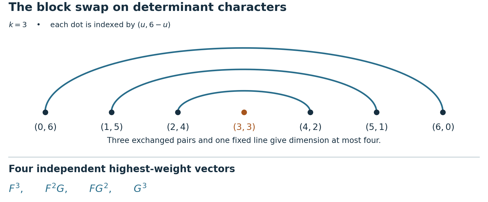

# A width-seven plethysm ray from the quartic of a three-form

Let $V=\mathbb C^7$, and write $S_\alpha V$ for the irreducible polynomial representation of highest weight $\alpha$. One family of constituents in the symmetric powers of $\Lambda^4 V$ has multiplicities $1,2,3,4,\ldots$. More precisely, with $\mu=(6,4,4,4,2,2,2)$,

$$
 \boxed{\displaystyle
 [\operatorname{Sym}^{6k}(\Lambda^4 V):S_{k\mu}V]=k+1
 \qquad(k\ge0).}
$$

The direct sum of these highest-weight spaces, graded by $k$ and multiplied in the symmetric algebra, is a polynomial ring on two generators in degree one. Those generators come from the quartic invariant of a three-form on a six-dimensional space. The ray lies in the infinite symmetric-algebra factor that appears at width seven in Sarkar’s reduction of stable Foulkes coefficients. Sarkar identified the failure of multiplicity-freeness at that width. [Sarkar, Proposition 7.1 and Remark 7.5](https://arxiv.org/pdf/2610.07929v2#page=12) · [Hitchin, §2.1](https://arxiv.org/pdf/math/0010054#page=3)

## Two generators on alternating three-forms

The exterior product gives $\Lambda^4 V\simeq(\Lambda^3 V)^*\otimes\det V$. In degree $6k$, dualizing and twisting complements the partition $k\mu$ in the seven-row rectangle of width $6k$. Its complement is $k(4,4,4,2,2,2,0)$. This correspondence respects multiplication of highest-weight vectors: in ordered bases it is induced by exterior complementation and reversal of the flag, with one determinant twist per symmetric degree. A weight with last coordinate zero uses only the first six indices. Every raising operator involving the seventh index annihilates these monomials. We can therefore compute in the polynomial algebra of $\Lambda^3 U^*$, where $U=\mathbb C^6$, using the weight $\lambda=(4,4,4,2,2,2)$.

Fix an ordered basis $e_1,\ldots,e_6$, its dual volume form $\varepsilon$, and the coordinate $x_{ijk}(X)=X(e_i,e_j,e_k)$ for $X\in\Lambda^3 U^*$. Define $K_X\in\mathrm{End}(U)$ by

$$
 \iota_{K_X u}\varepsilon=(\iota_u X)\wedge X .
$$

Hitchin’s relative invariant $D=\operatorname{tr}(K_X^2)/6$ has degree four and coordinate-ring weight $(2,2,2,2,2,2)$. Here we use the natural action on polynomial functions, for which the linear coordinates form $\Lambda^3 U$. Set

$$
 p=x_{123},\qquad q=\frac{\partial D}{\partial x_{456}},
 \qquad F=p^2D,\qquad G=q^2.
$$

For the upper-triangular Borel, $p$ is a highest-weight coordinate. In the dual representation the highest-weight direction for differentiation is $e^4\wedge e^5\wedge e^6$, of weight $(0,0,0,-1,-1,-1)$. Acting on the relative invariant gives $q$ of weight $(2,2,2,1,1,1)$. Thus $F$ and $G$ are both highest-weight vectors of degree six and weight $\lambda$. [Hitchin, Definition 1 and Proposition 1](https://arxiv.org/pdf/math/0010054#page=3)

Write $e^{ijk}=e^i\wedge e^j\wedge e^k$. Two evaluations of the defining wedge product give

$$
 D(ae^{123}+be^{456})=a^2b^2,\qquad
 D(e^{126}+e^{135}+e^{234}+te^{456})=-4t.
$$

The first family at $a=b=1$ gives $(F,G)=(1,4)$. The second at $t=0$ gives $(0,16)$. Hence $G/F$ is nonconstant. Both polynomials have the same positive degree, so a polynomial relation between them would yield a nonzero homogeneous relation. Dividing by the appropriate power of $F$ would make $G/F$ algebraic over the algebraically closed field $\mathbb C$. This proves their algebraic independence. The monomials $F^{k-j}G^j$, $0\le j\le k$, already provide $k+1$ independent vectors. [Symbolic exterior-product check, Python with SymPy](checks/trivector_covariants.py)

## The upper bound from the open orbit

Split $U=A\oplus B$ into the first and last three coordinates. Hitchin’s Proposition 1 identifies the open orbit of $X_0=e^{123}+e^{456}$ as the locus where $D\ne0$. Its stabilizer contains $H=(\mathrm{SL}(A)\times\mathrm{SL}(B))\rtimes\langle\sigma\rangle$, where the block swap $\sigma$ interchanges $e_i$ and $e_{i+3}$ for $1\le i\le3$. If an equivariant map from $S_{k\lambda}U$ into polynomial functions evaluates to the zero functional at $X_0$, it vanishes on the entire orbit and hence everywhere. Evaluation at $X_0$ therefore bounds the multiplicity by $\dim\bigl(((S_{k\lambda}U)^*)^H\bigr)$. [Hitchin, Proposition 1 and its open-orbit calculation](https://arxiv.org/pdf/math/0010054#page=4)

Factor $\det^{2k}$ out of $S_{k\lambda}U$. The remaining shape is the three-row rectangle $((2k)^3)$. Upon restriction to $\mathrm{GL}(A)\times\mathrm{GL}(B)$, its $\mathrm{SL}(A)\times\mathrm{SL}(B)$-invariants can come only from determinant-character pairs $\det_A^u\otimes\det_B^v$ with $u,v\ge0$. The branching multiplicity is the Littlewood–Richardson coefficient

$$
 c_{(u^3),(v^3)}^{((2k)^3)}=
 \begin{cases}
 1 & u+v=2k,\\
 0 & u+v\ne2k .
 \end{cases}
$$

Indeed the coefficient can be computed using three variables, where the tensor product is $\det^u\otimes\det^v$. Thus there are $2k+1$ invariant lines before imposing the block swap. It exchanges the lines indexed by $u$ and $2k-u$. Each of the $k$ pairs contributes at most one fixed dimension, and the middle line contributes at most one. The common determinant twist acts trivially on the connected subgroup and leaves these pairings intact. Duality preserves the same bound. The $k+1$ monomials constructed above attain it in every degree and consequently generate the entire ray algebra.

*At $k=3$, the stabilizer bounds the dimension by four and the four monomials span. The arcs describe restriction to the stabilizer. The monomials form a basis in the polynomial representation.* [Reproducible figure](checks/plethysm_block_swap_figure.py)

## The full stable coefficient at the first tail

The conjugate of $k\mu$ is $\kappa_k=(7^{2k},4^{2k},1^{2k})$ for $k\ge1$. For a partition $\kappa$ with $\kappa_1\le7$, Sarkar identifies its stable Foulkes coefficient $c(\kappa)$ with the multiplicity of $S_{\kappa'}V$ in

$$
 M_7=\bigotimes_{i=2}^7
 \begin{cases}
    \operatorname{Sym}^{\bullet}(\Lambda^i V)& i\ \text{even},\\
    \Lambda^{\bullet}(\Lambda^i V)& i\ \text{odd}.
 \end{cases}
$$

Taking degree zero in the five factors other than $i=4$ gives $c(\kappa_k)\ge k+1$. At $k=1$, the single-factor contribution is $2$. Across all factors the complete value is **2,097**. If $r$ is the outer symmetric degree and $s$ the inner symmetric degree, Sarkar’s stability theorem applies for $s\ge\kappa_1$ and $r\ge\lfloor(|\kappa|+\kappa_1)/2\rfloor$, whenever $(rs-|\kappa|,\kappa)$ is a partition. Thus the first tail, $\kappa=(7,7,4,4,1,1)$, already gives the finite identity

$$
 \big\langle h_{15}[h_7],s_{(81,7,7,4,4,1,1)}\big\rangle=2097 .
$$

Here $h_j$ denotes a complete homogeneous symmetric function, $s_\alpha$ a Schur function and the brackets denote plethysm. [Sarkar, Theorem 6.4 and Proposition 7.1](https://arxiv.org/pdf/2610.07929v2#page=11)

The accompanying standard-library Python program computes 2,097 in two ways. First it takes the product character of $M_7$, computes its weights by the logarithmic derivative of the symmetric and exterior products, and extracts the coefficient of $S_\mu$ by the Weyl alternant. Second it applies Sarkar’s formula (7) in six variables, counting unordered vector partitions in which every part has coordinate sum at least two. The same program decomposes $\operatorname{Sym}^d(\Lambda^3 V)$ in degrees one to six and checks the dimension total $\binom{34+d}{d}$. Complementation shows that degrees one through five of $\operatorname{Sym}(\Lambda^4 V)$ are multiplicity-free and that $\mu$ is the sole repeated weight in degree six. It also checks the single-factor dimensions at $k=1,2,3,4$. [Exact character and vector-partition computations](checks/width_seven.py) · [Sarkar, formula (7)](https://arxiv.org/pdf/2610.07929v2#page=13)
