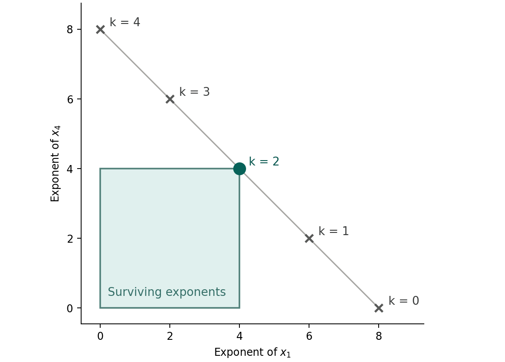

# An exceptional Hecke fibre and the order of a Hasse coefficient

A specialization of the rank-four nonstandard Hecke algebra has a 94-dimensional image in its ordinary regular representation. The integral order at that point requires at least **126 module generators**. The missing information becomes visible one power of the maximal ideal at a time. In the permanent problem, the order of vanishing of a single coefficient detects repeated padding and gives a sharp generic bound depending on its exponent. The two calculations use different rings and give different kinds of information about geometric complexity theory.

## Counting generators through a nilpotent neighbourhood

Let $S=\mathbb Z[1/2,D]$, let $t=D+1$, and put $\mathfrak m=(3,t)$. In the ordinary type-$A_3$ Hecke algebra let $T_1,T_2,T_3$ be the braid generators with $(T_i-v)(T_i+v^{-1})=0$. The nonstandard word order $B$ is the $S$-span of all words, including the identity, in

$$
 P_i=(T_i+v^{-1})\otimes(T_i+v^{-1})+(T_i-v)\otimes(T_i-v),
 \qquad D=(v+v^{-1})^2 .
$$

These are the generators of Blasiak, Mulmuley and Sohoni. Here the coefficient ring retains the integer 3. [Blasiak, Mulmuley and Sohoni, *Geometric Complexity Theory IV*](https://arxiv.org/abs/cs/0703110v4)

**Proposition.** Every system of $S_{\mathfrak m}$-module generators of $B_{\mathfrak m}$ has at least 126 elements. Its generic rank is 114, so the order fails to be locally free at $\mathfrak m$.

**Finite proof.** Write $a=v-v^{-1}$, so that $D=a^2+4$. On the basis $T_w$, indexed by the 24 permutations of four letters, right multiplication has the formula

$$
 T_w T_i = T_{ws_i}+
 \begin{cases}
 aT_w &\text{if } w(i)>w(i+1),\\
 0 &\text{otherwise}.
 \end{cases}
$$

Thus each $P_i$ acts on $24^2$ ordinary tensor coordinates using

$$
 2T_i\otimes T_i-a(T_i\otimes 1+1\otimes T_i)+(a^2+2)1.
$$

For $N=1,2,3,4$ take $A_N=\mathbb Z[s]/(3,s)^N$, set $a=1+s$, and let $W_N$ be the $A_N$-span of all words applied to $1\otimes1$. The map from $S_{\mathfrak m}$ to $A_N$ sends $t$ to $6+2s+s^2$; the two resulting maximal ideals agree since $2+s$ is a unit. Any generating set of $B_{\mathfrak m}$ therefore generates $W_N$ after changing scalars. The table lists additive lengths $\log_3|\cdot|$.

| $N$ | $W_N$ | $(3,s)W_N$ | $\dim_{\mathbb F_3}W_N/(3,s)W_N$ |
|---:|---:|---:|---:|
| 1 | 94 | 0 | 94 |
| 2 | 310 | 188 | 122 |
| 3 | 642 | 516 | **126** |
| 4 | 1088 | 962 | 126 |

Here is a reproducible construction of the finite modules. In each tensor coordinate store the coefficients of $1,s,\ldots,s^{N-1}$; the coefficient of $s^j$ is taken modulo $3^{N-j}$. Multiplying that coefficient by $3^j$ embeds the additive group in a product of copies of $\mathbb Z/3^N$. Maintain one echelon basis for each successive power of 3. A new pivot in layer $j$ also inserts its triple in layer $j+1$; a row whose residue vanishes descends to the next layer by division by 3. The number of pivots across the layers is the additive length. This follows by taking the successive images of the subgroup in $3^j E/3^{j+1}E$ for the ambient additive group $E$.

Starting at the identity, add a word and its $s$-multiples whenever it enlarges the current module, then test its three right products. If a word is already in the module, its right products are linear combinations of right products of the retained generators. The finite queue thus computes the full generated module. The same generators multiplied by 3 and $s$ give its maximal-ideal multiple. The $N=3$ result proves the proposition. The accompanying Python program implements these formulas directly and uses NumPy for integer arrays. It takes no Hecke tables or research data as input. [Regular-representation calculation](checks/regular_hecke_order.py)

For the generic rank, the nine simple blocks over the generic Hecke field have sizes $1,2,3,6,5,5,2,3,1$. Their squared sizes sum to 114. This rank descends to $\mathbb Q(D)$. Indeed the involution $a\mapsto-a,\ T_i\mapsto-T_i$ fixes $P_i$. Each word coefficient at $T_u\otimes T_w$ is a polynomial in $a$ of parity $\ell(u)+\ell(w)$. Divide each odd column by $a$; all resulting entries belong to $\mathbb Q[a^2]=\mathbb Q[D]$. Matrix rank then agrees over the two fields. [Blasiak, Mulmuley and Sohoni, §11.8](https://arxiv.org/pdf/cs/0703110v4#page=67)

The generic computation in §11.8 stopped at word length nine. At the integral point, words of length at most nine miss at least two generators. To see this, start the same additive elimination at $(3,s)W_3$ and insert the words by length. The dimensions contributed through lengths $0$ to $10$ are

$$
1,\quad 4,\quad 9,\quad 17,\quad 30,\quad 49,\quad 73,\quad 96,\quad 114,\quad 124,\quad 126.
$$

Breadth-first insertion preserves the filtration because every skipped word is a combination of retained words of at most its own length. The two words $P_{1212321232}$ and $P_{1212321321}$ give independent classes modulo the length-nine span in this finite quotient, with subscripts recording generator order. Consequently a linear reduction of every length-ten word to shorter ones over the generic field must use coefficients outside $S_{\mathfrak m}$ for at least these two words. [Published generic computation](https://arxiv.org/pdf/cs/0703110v4#page=68)

## The integral quotient in an adapted lattice

There is a sharper description relative to the ambient monic lattice $L$ of the unpublished AI-created study *Degree selection and positivity for nonstandard Hecke algebras of ranks three and four*, section “An integral form after inverting six.” It uses three finite data about that lattice.

1. $L$ is free of rank 114 over $S$, contains $B$, and $B[1/3]=L[1/3]$.
2. $M=L/B$ has $M/3M\simeq(\mathbb F_3[D]/(D+1))^{12}$. The calculation of the word image reduces 148 words and checks closure of the resulting rows under all three generators.
3. On reducing the same word coordinates modulo $\mathfrak m^2$, 102 unit pivots leave twelve columns. Write the remaining entries $3u_j+tv_j$. In the 24 columns $(u_1,\ldots,u_{12},v_1,\ldots,v_{12})$, a $24$-row minor has determinant $2\bmod3$.

The first two data are supplied by that study. The third comes from multiplying its 342 generator-action rows on the mixed-characteristic neighbourhood. The underlying adapted matrices have no public deposit identified here. Accordingly the quotient description below depends on these data. The regular-representation proof above gives the 126-generator lower bound independently. The two residue ranks, 94 and 102, refer to images in different ambient lattices. [Published workbench contents at the version consulted](https://github.com/KokunoYumeto/geometric-complexity-theory-workbench/tree/94573031d82192e03e664627676b2aa7fbc48246)

**Deduction from the adapted data.** Since $M[1/3]=0$ and $M$ is finite as an $S$-module, $3^eM=0$ for some $e$. The second datum gives $tM\subseteq3M$, so $t^eM=0$ as well. Thus $M$ is supported at $\mathfrak m$. The ring $S/\mathfrak m^2$ is $(\mathbb Z/9)[t]/(3t,t^2)$. The third datum spans all $3$- and $t$-multiples of the twelve remaining generators in this ring. Hence $\mathfrak m M/\mathfrak m^2M=0$, and Nakayama's lemma applied to $\mathfrak mM_{\mathfrak m}$ gives $\mathfrak mM=0$. We obtain

$$
 M\simeq(S/\mathfrak m)^{12},\qquad
 B_{\mathfrak m}\simeq S_{\mathfrak m}^{102}\oplus
 (\mathfrak m S_{\mathfrak m})^{\oplus12}.
$$

For the second assertion choose a basis of $L_{\mathfrak m}$ adapted to its surjection onto the twelve-dimensional residue quotient. The maximal ideal of this regular local surface has two minimal generators, giving the exact total $102+2\cdot12=126$. On blowing up the point, the torsion-free pullback replaces each copy of the ideal by $\mathcal O(-E)$, where $E$ is the exceptional curve. The determinant of the inclusion therefore vanishes along $E$ to order twelve. [Stacks Project, blowing up a regular surface at a point](https://stacks.math.columbia.edu/tag/0AGP)

## Repeated padding and the Hasse coefficient

Let $K$ be an algebraically closed field of prime characteristic $p$. For a form $F$ of degree $n$ in $n$ variables define a polynomial on its coefficient space by

$$
 h_p(F)=[(x_1\cdots x_n)^{p-1}]F^{p-1}.
$$

On a smooth Calabi–Yau hypersurface the expression is the Hasse coefficient in the usual monomial trivialization. The expression itself is defined on the entire coefficient space. Bhatt and Singh study the order of the Hasse invariant on the versal deformation space of a smooth hypersurface. The next calculation takes the order in the affine space of all forms and applies also to singular padded forms. [Bhatt and Singh, *The F-pure threshold of a Calabi–Yau hypersurface*, §4](https://arxiv.org/abs/1307.1171v2)

**Theorem.** In $Q=K[x_1,\ldots,x_n]/(x_1^p,\ldots,x_n^p)$, put $r=\max\{j\ge0:F^j\ne0\text{ in }Q\}$. Then

$$
 \operatorname{ord}_{F}(h_p)=p-1-r.
$$

Indeed the homogeneous degree-$k$ term of $h_p(F+H)$, in the coefficients of a general perturbation $H$, is the socle coefficient of $\binom{p-1}{k}F^{p-1-k}H^k$. Complementary homogeneous degrees in $Q$ pair perfectly by taking the coefficient of $\prod_i x_i^{p-1}$, since each monomial has a unique complementary monomial. Every monomial of degree $kn$ factors into $k$ degree-$n$ monomials. If $F^{p-1-k}\ne0$, choose such factors with nonzero socle pairing. The coefficient of the associated perturbation monomial differs from that pairing by the binomial factor and a multinomial factor dividing $k!$. Both are units for $k<p$. Thus the first nonzero order is $p-1-r$.

Let $a\ge1,\ b\ge2,\ n=a+b$. Any linear restriction of a padded permanent to these $n$ variables has the form $F=L^a g$, with $g$ a restriction of $\operatorname{per}_b$. Since $L^p=0$ in $Q$, the theorem gives

$$
 \operatorname{ord}_{F}(h_p)\ \ge\
 p-1-\left\lfloor\frac{p-1}{a}\right\rfloor .
$$

A diagonal permanent gives $F=x_1^a x_2\cdots x_{b+1}$ and attains the bound. Nonvanishing of the corresponding power in $Q$ is open in the linear restriction parameters, so this is the generic order. For example in characteristic five the pencil

$$
 F_z=x_1^2x_2x_3+z x_2x_3x_4^2
$$

has $h_5(F_z)=\binom42 z^2=z^2$. At its padded member $z=0$, the value and the first derivative vanish, while the quadratic coefficient survives. A diagonal restriction of $\det_n$ gives $x_1\cdots x_n$ and $h_p=1$, so a generic determinant restriction has order zero.

*The coefficient of $z^k$ in $F_z^4$ has $x_1,x_4$ exponents $(8-2k,2k)$. Both $x_2$ and $x_3$ have exponent four throughout. The quotient kills any exponent above four, leaving just $k=2$.* [Figure source](checks/padding_exponents_figure.py)

For $a\ge2$, this equation vanishes on the projected padded-permanent locus and takes a nonzero value on the projected determinant locus. It obstructs containment of the projected determinant locus **in the padded locus**, in characteristic $p$. The permanent-versus-determinant question asks whether the padded permanent lies in a determinant orbit closure over $\mathbb C$. A separating equation there would have to vanish on the determinant and survive on the padded permanent. [Bürgisser, Ikenmeyer and Panova, *No occurrence obstructions in geometric complexity theory*](https://arxiv.org/abs/1604.06431)
